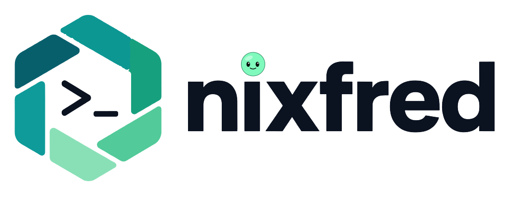
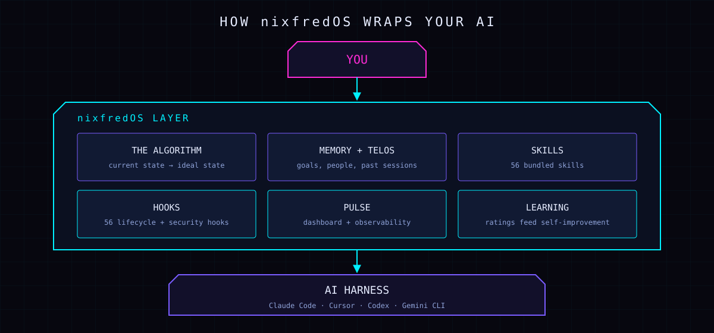

<p align="center">
  <picture>
    <source media="(prefers-color-scheme: dark)" srcset="brand/nixfred-logo.svg">
    
  </picture>
</p>

<p align="center">
  <a href="https://github.com/nixfred/nixfredOS"></a>
  
  
  
</p>

# nixfredOS

Start at https://nixfredos.com; the steps live at https://how.nixfred.com.

**nixfredOS turns a general AI coding harness into a personal operating system.** It learns your goals, remembers your past sessions, routes each request to the right skill, and guards your machine with hooks that check every action before it runs.

Your harness is the engine. nixfredOS is the rest of the car.

<p align="center">
  
</p>

## Start here

[how.nixfred.com](https://how.nixfred.com) walks your agent through building your own, in order. Free plus your subscription. Don't trust me, [audit it](https://github.com/nixfred/how.nixfred.com-public).

The recipe box is the recipe, not the goal.
Build it once, then hand your Larry any repo and build anything.

The Laws Larry works by live at [larry.nixfred.com](https://larry.nixfred.com).

<sub>You can do all of this yourself, free plus your subscription. If you want help with advanced work, I am available, and it is not free and not cheap: [book a call](mailto:frednix@gmail.com).</sub>

Steps: https://how.nixfred.com

## What you get

| Component | What it does |
|---|---|
| **The Algorithm** | Every task moves from *current state* to a defined *ideal state*, with criteria you can verify |
| **Memory + TELOS** | Goals, people, preferences and past decisions, available without re-explaining |
| **Skills** | Bundled skills: research, security, writing, art, first principles, red teaming and more |
| **Hooks** | Lifecycle hooks: security guards, integrity checks, context loading, learning capture |
| **Pulse** | Local dashboard and observability for what your AI is doing |
| **Status line** | Neon 5-line cockpit: context, git, memory, plan pace (banked, never dollars), local GPU and weather (opt-in). On by default at install, never replacing a status line you already have. Adapts to pane size |
| **Mod** | [`nixfredos-laws`](nixfredOS/install/skills/nixfredos-laws/), a Claude Code mod: a band above the prompt that counts failed commands (three strikes, then research) and reads out the remote and its visibility before every commit and push, part of Larry's [Laws](https://larry.nixfred.com) |
| **Learning** | Ratings and outcomes feed back so the system improves itself |

Browse the skills in [`nixfredOS/install/skills/`](nixfredOS/install/skills/) and the hooks in [`nixfredOS/install/hooks/`](nixfredOS/install/hooks/).

## FAQ

**Which harness does it run on?**
Claude Code is the most tested path. The install guide is written so any capable coding assistant (Cursor, Cline, Codex, Gemini CLI) can follow it.

**What if I break something?**
The install is additive. It writes its own files and asks before each integration step, so your existing setup stays in place.

**How is this different from Fabric?**
[Fabric](https://github.com/danielmiessler/fabric) is a library of prompts for specific tasks. nixfredOS is the system around your AI: memory, routing, guards and learning. It bundles Fabric patterns as one of its skills.

## Repository layout

```
nixfredOS/
├── README.md          you are here
├── LICENSE            MIT
├── images/            banner and diagrams
├── Releases/          versioned release snapshots
└── nixfredOS/
    ├── INSTALL.md     the AI-readable install guide
    ├── GETTING-STARTED.md
    └── install/       skills, hooks, agents, settings, tools
```

## License

MIT. See [LICENSE](LICENSE).

---

nixfredOS is a fork of LifeOS by Daniel Miessler, MIT licensed.
