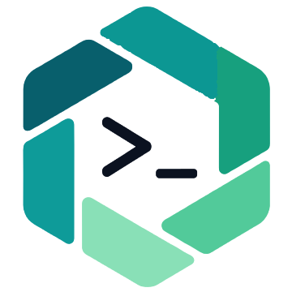
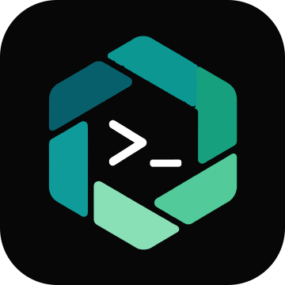
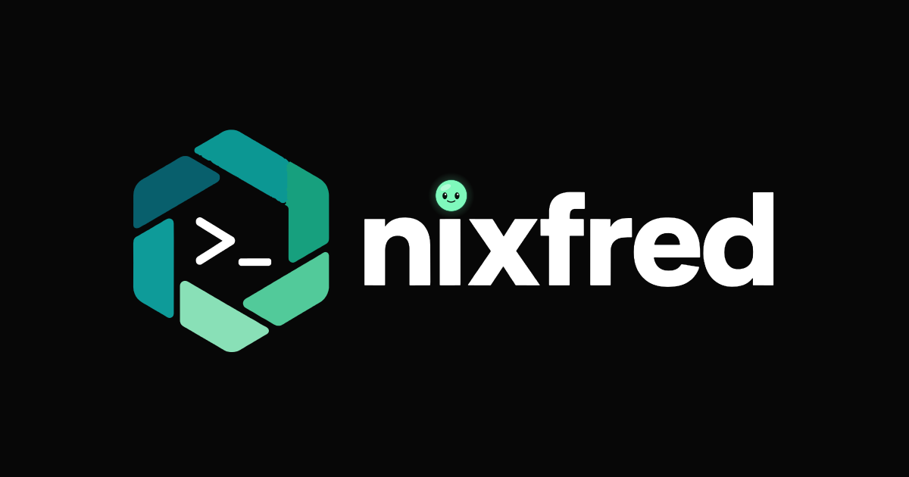

# nixfred brand standard

The nixfred logo is a five-segment teal-to-mint hexagon with a `>_` prompt inside, next to a bold `nixfred` wordmark whose i-dot is a small glowing mint Larry face. These files are the source of truth. The SVGs are redrawn from the master lockup; the redraw matches it at PSNR 40.1 dB. Do not recolor, stretch, outline or re-typeset them. Use the files as shipped.

  <picture>
    <source media="(prefers-color-scheme: dark)" srcset="nixfred-logo.svg">
    
  </picture>

## The one rule: where Larry's face goes

The Larry smiley face appears **only** as the dot on the `i` in the `nixfred` wordmark. It never goes inside the hexagon. The hexagon icon always shows just the `>_` prompt: white on dark backgrounds, `#0b1220` on light ones. That holds for every icon, favicon, app icon, avatar and lockup, and for anything new made from these files.

## Which file to use where

| Need | File | Notes |
|---|---|---|
| Full lockup on a dark page | [`nixfred-logo.svg`](nixfred-logo.svg) | Transparent background, white wordmark and prompt. |
| Full lockup on a light page | [`nixfred-logo-light.svg`](nixfred-logo-light.svg) | Same art with a dark wordmark and prompt (`#0b1220`). |
| Stacked lockup, dark page | [`nixfred-logo-stacked.svg`](nixfred-logo-stacked.svg), [`nixfred-logo-stacked.png`](nixfred-logo-stacked.png) | Icon above the wordmark, for square or tall slots with room for the name. PNG is 1024 px wide, transparent. |
| Stacked lockup, light page | [`nixfred-logo-stacked-light.svg`](nixfred-logo-stacked-light.svg), [`nixfred-logo-stacked-light.png`](nixfred-logo-stacked-light.png) | Same, dark wordmark and prompt. |
| Icon only, dark page | [`nixfred-icon.svg`](nixfred-icon.svg) | Hexagon and `>_`, transparent, white prompt. |
| Icon only, light page | [`nixfred-icon-light.svg`](nixfred-icon-light.svg) | Same with a dark prompt. |
| Browser tab icon (vector) | [`nixfred-favicon.svg`](nixfred-favicon.svg) | Icon on a `#070707` rounded tile (corner radius 20% of the side). Works on light and dark tabs. |
| Browser tab icon (legacy) | [`favicon.ico`](favicon.ico) | 16, 32 and 48 px in one file. |
| 16 px PNG | [`favicon-16.png`](favicon-16.png) | Same tile as the favicon SVG. |
| 32 px PNG | [`favicon-32.png`](favicon-32.png) | Same tile. |
| 180 px PNG, iOS home screen | [`apple-touch-icon.png`](apple-touch-icon.png) | Opaque `#070707` square (iOS rounds it). Source: [`nixfred-apple-touch.svg`](nixfred-apple-touch.svg). |
| Android and PWA maskable icon | [`maskable-512.png`](maskable-512.png) | 512 px, full-bleed `#070707`, icon kept inside the central 62% safe zone so any mask shape keeps it whole. Source: [`nixfred-maskable.svg`](nixfred-maskable.svg). |
| Social share card | [`og.png`](og.png) | 1200x630, lockup centered on `#070707`. Source: [`nixfred-og.svg`](nixfred-og.svg). |

For ordinary PWA icons (192 and 512) render [`nixfred-apple-touch.svg`](nixfred-apple-touch.svg) at that size, as ladder.nixfred.com does.

## Colors

Read straight from the SVG source (`grep` of the `fill`, `stroke` and `stop-color` values), not eyeballed.

| Part | Hex |
|---|---|
| Hexagon, top-left segment | `#085f6c` |
| Hexagon, top segment | `#0c9793` |
| Hexagon, right segment | `#17a07e` |
| Hexagon, left segment | `#0e9b99` |
| Hexagon, bottom-right segment | `#52ca9a` |
| Hexagon, bottom segment | `#89e0b7` |
| Larry face (i-dot) fill and glow | `#7ff9bc` |
| Larry face rim, on dark | `#0a3a28` |
| Larry face rim, on light | `#0b6b48` |
| Larry face eyes and smile | `#05120c` |
| Wordmark and `>_`, on dark | `#fff` |
| Wordmark and `>_`, on light | `#0b1220` |
| Dark tile and card background | `#070707` |

The glow around the face is a `#7ff9bc` radial gradient and appears on dark only; the light variant drops it.

## When to use the icon only

Use `nixfred-icon*.svg`, or the tile files, whenever the slot is square or small and the wordmark would shrink past reading:

- favicons, app and home-screen icons, PWA icons;
- avatars and profile pictures;
- a header slot that is a glyph rather than a wordmark;
- anywhere the lockup would render under the minimum width below.

Use the full lockup wherever there is horizontal room: page headers, README banners, slides, share cards.

## Minimum size and clear space

These are derived from the artwork, measured on the 1280x720 master, not rules handed down by a designer. Treat them as sensible defaults.

- **Clear space, lockup:** keep at least one wordmark x-height free on every side. The x-height of the `n` measures 104 px against a 345 px tall lockup, about 30% of its height.
- **Clear space, icon only:** keep at least 18% of the icon width free. That is the gap the master leaves between the hexagon (304 px wide) and the wordmark (56 px).
- **Minimum size, lockup:** 160 px wide. The Larry face is about 4.9% of the lockup width, so at 160 px it is still about 8 px across; below that the eyes and smile are lost. Go icon-only instead.
- **Minimum size, icon:** 32 px for the `>_` to show as a 1 px line (the prompt strokes are about 3.3% of the icon width). At 16 px the hexagon ring still reads but the prompt is a smudge, which is why 16 px is only used for favicons.

## Previews

The lockup and icons below switch with your GitHub theme: dark theme shows the dark-page file, light theme shows the light-page file. The tile and card have their own backgrounds.

| Lockup | Icon | Favicon tile | Share card |
|---|---|---|---|
| <picture><source media="(prefers-color-scheme: dark)" srcset="nixfred-logo.svg"></picture> | <picture><source media="(prefers-color-scheme: dark)" srcset="nixfred-icon.svg"></picture> |  |  |

Stacked lockup (switches with your GitHub theme):

  <picture>
    <source media="(prefers-color-scheme: dark)" srcset="nixfred-logo-stacked.svg">
    
  </picture>

Dark page and light page, side by side as files:

| Dark (`nixfred-logo.svg`) | Light (`nixfred-logo-light.svg`) |
|---|---|
|  |  |

Only one of those two shows at a time on GitHub (the `#gh-dark-mode-only` and `#gh-light-mode-only` suffixes pick by theme). Open each SVG on its own to see the other.
